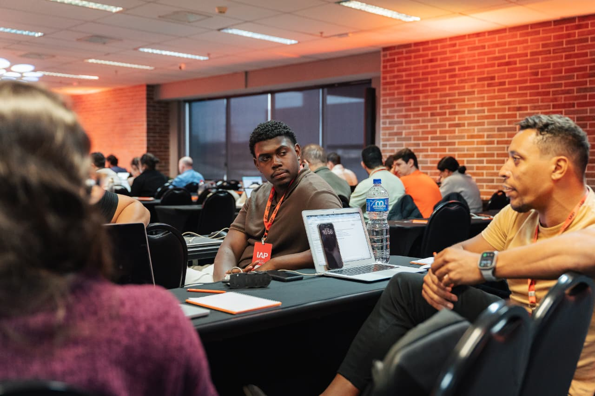
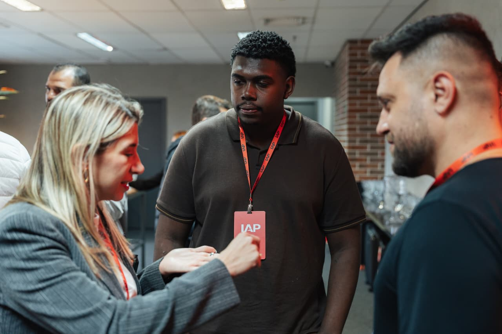
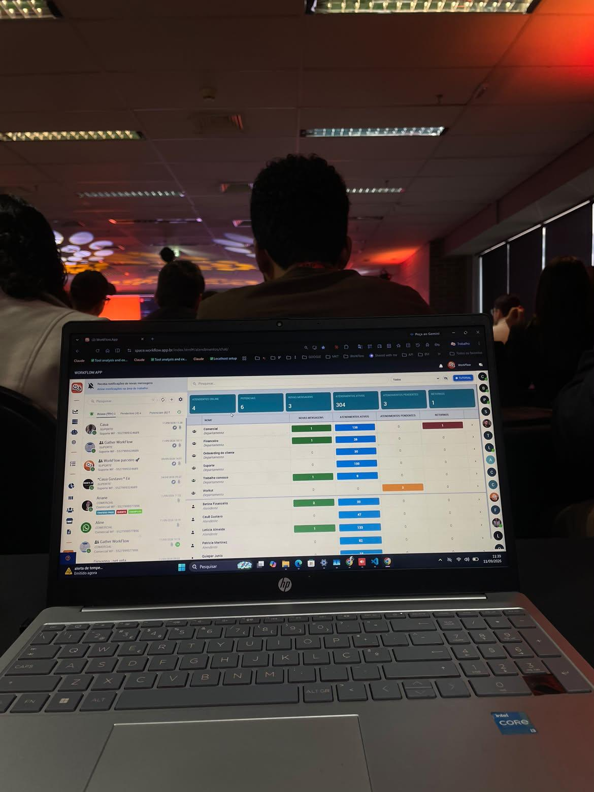
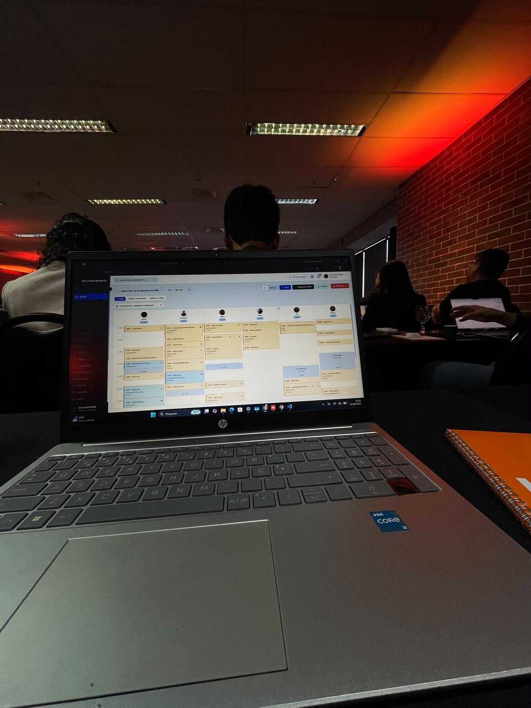
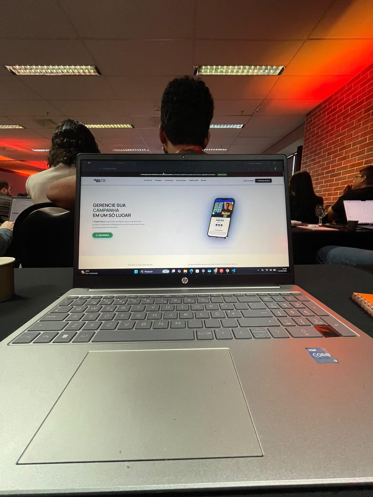
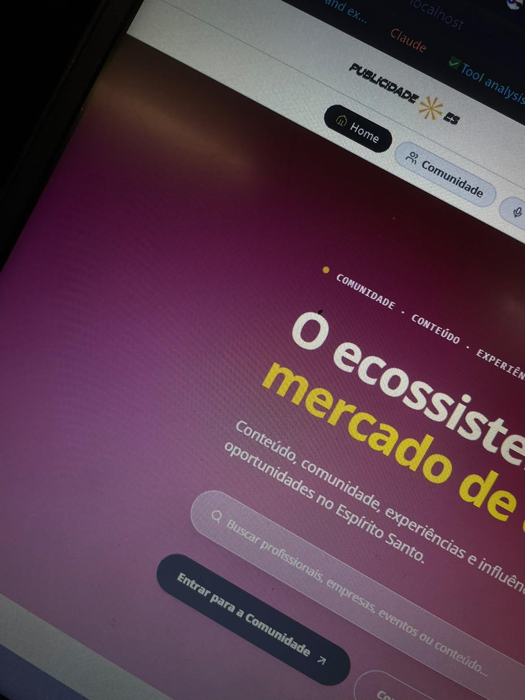
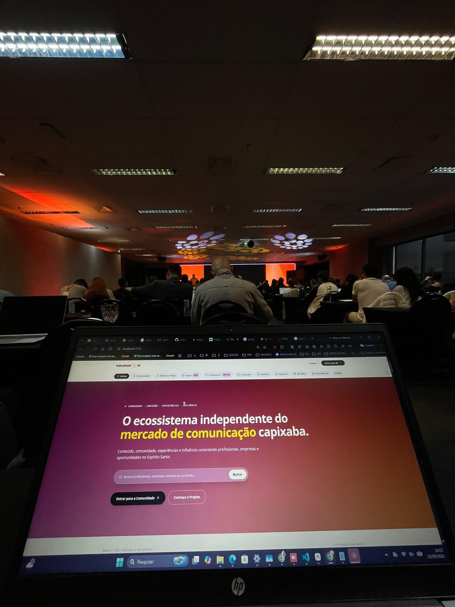
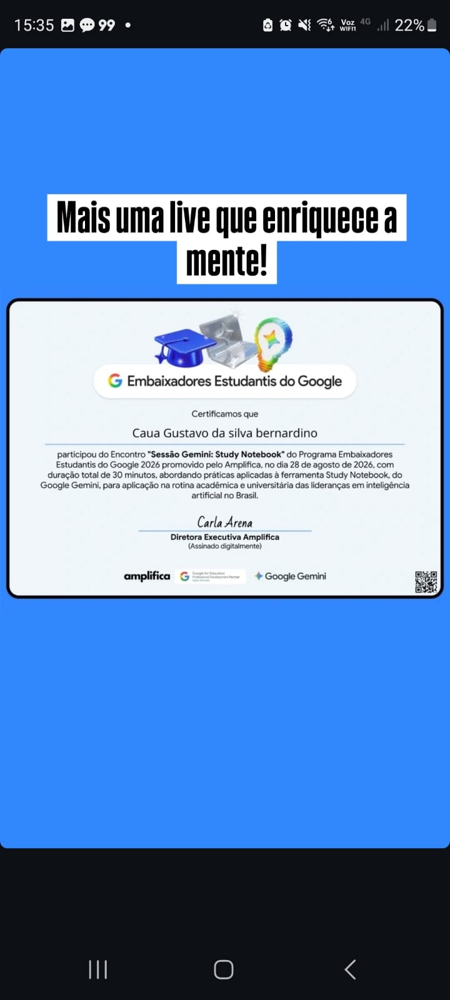

<div align="center">

<!-- HEADER BANNER ANIMADO -->


<!-- FOTO DE PERFIL OFICIAL -->
<p align="center">
  
</p>

<p align="center">
  
</p>

<!-- LINKS DOS SITES NO AR -->
<p align="center">
  <a href="https://workflow.app.br/" target="_blank"></a>
  <a href="https://workut.cc/" target="_blank"></a>
  <a href="https://www.vetio.cc/" target="_blank"></a>
  <a href="https://www.publiview360.com.br/" target="_blank"></a>
  <a href="https://www.publiview.online/" target="_blank"></a>
  <a href="https://business.publiview360.com.br/" target="_blank"></a>
  <a href="https://publicidadees.com.br/" target="_blank"></a>
  <a href="https://www.joysweet.online/" target="_blank"></a>
</p>

<!-- STATUS BADGES -->
<p align="center">
  <a href="https://www.linkedin.com/in/cau%C3%A3-gustavo-da-silva-bernardino-455005304/" target="_blank"></a>
  <a href="#-atuação-profissional-workflow-business"></a>
  <a href="#-embaixador-estudantil-do-google-2026"></a>
  <a href="#-as-6-plataformas-digitais-documentação-mestra"></a>
  <a href="#-ecossistema-em-números"></a>
</p>

<p align="center">
  📍 <strong>Espírito Santo, Brasil</strong> &nbsp;|&nbsp; 
  🎂 <strong>21 anos</strong> &nbsp;|&nbsp; 
  💼 <strong>Full Stack & AI Engineer</strong> &nbsp;|&nbsp; 
  🔗 <a href="https://www.linkedin.com/in/cau%C3%A3-gustavo-da-silva-bernardino-455005304/" target="_blank"><strong>LinkedIn</strong></a> &nbsp;|&nbsp; 
  🌐 <a href="https://github.com/cauag1834-maker"><strong>@cauag1834-maker</strong></a>
</p>

---

</div>

## 📌 Navegação Rápida

- [👋 Sobre Mim](#-sobre-mim)
- [🌟 Clientes & Parceiros de Referência](#-clientes--parceiros-de-referência)
- [🏢 Atuação Profissional: Workflow Business](#-atuação-profissional-workflow-business)
- [🚀 As 6 Plataformas Digitais (Documentação Mestra)](#-as-6-plataformas-digitais-documentação-mestra)
  - [1. Workut — Gestão para Beleza & Bem-Estar](#1--workut--gestão-para-beleza--bem-estar)
  - [2. Vetio 2.0 — Ecossistema Pet & Smart Tags](#2--vetio-20--ecossistema-pet--smart-tags)
  - [3. PubliView360 + PubliOnline — Gestão Política 360](#3--publiview360--publionline--gestão-política-360)
  - [4. HELPIA — Atendimento Inteligente, CRM & ERP](#4--helpia--atendimento-inteligente-crm--erp)
  - [5. MedSystem — Saúde, Prontuário IA & Prescrição Memed](#5--medsystem--saúde-prontuário-ia--prescrição-memed)
  - [6. Publicidade ES — Ecossistema Capixaba & Podcast Manda o Papo](#6--publicidade-es--ecossistema-capixaba--podcast-manda-o-papo)
- [🏆 Reconhecimentos, Pesquisa & Impacto](#-reconhecimentos-pesquisa--impacto)
- [📈 Métricas & Tração do Portfólio](#-métricas--tração-do-portfólio)
- [🛠️ Stack Tecnológica & Infraestrutura](#-stack-tecnológica--infraestrutura)
- [🤝 Sócios, Apoiadores & Investidores](#-sócios-apoiadores--investidores)
- [📸 Galeria de Atuação](#-galeria-de-atuação)
- [📬 Contato & Conexão](#-contato--conexão)

---

## 👋 Sobre Mim

Olá! Sou **Cauã Gustavo da Silva Bernardino**, desenvolvedor de software de 21 anos residente no Espírito Santo. Atuo na intersecção entre **desenvolvimento full stack**, **arquitetura de sistemas SaaS multi-tenant**, **engenharia de inteligência artificial** e **automações avançadas de comunicação e atendimento**.

Atualmente faço parte da equipe da **Workflow Business**, referência capixaba em comunicação inteligente e chatbots de IA, onde sou responsável por integrações críticas de CRM, webhooks, infraestrutura e suporte especializado a clientes corporativos.

Em paralelo, sou autor técnico e co-fundador de **6 plataformas SaaS independentes** consolidadas no **Manual Técnico e de Negócios 2026 (Programa Supernova · Sebrae)**, com aplicações ativas em campanhas eleitorais, redes de estética, clínicas médicas veterinárias e no mercado criativo capixaba.

Também tenho a honra de ter sido selecionado como **Embaixador Estudantil do Google 2026** (Google Student Ambassador pelo programa Amplifica / Google for Education / Gemini) e autor de pesquisa de Iniciação Científica financiada pela **FAPES**.

<div align="center">
  <table>
    <tr>
      <td width="50%" align="center">
        
        <br />
        <em>Cauã Gustavo no Workshop "IA na Prática" (IAP)</em>
      </td>
      <td width="50%" align="center">
        
        <br />
        <em>Debatendo arquiteturas e integrações tecnológicas</em>
      </td>
    </tr>
  </table>
</div>

---

## 🌟 Clientes & Parceiros de Referência

O portfólio e as plataformas desenvolvidas reúnem clientes reais, mandatos, figuras públicas e redes empresariais em operação diária no Espírito Santo, no Brasil e no exterior:

| Cliente / Parceiro | Segmento / Perfil | Plataforma | O que Utilizou / Impacto Real Entregue |
| :--- | :--- | :--- | :--- |
| **Arnaldinho Borgo**<br>*(Prefeito de Vila Velha)* | Setor Público & Política | **PubliView360** | Atendimento à rede de candidatos alinhados ao seu grupo político nas Eleições 2026, com mobilização e canais digitais unificados. |
| **Lyza Herzog**<br>*(Candidata a Deputada Estadual)* | Mandato Parlamentar | **PubliView360 + PubliOnline** | **50 santinhos digitais interativos** e **20 números dedicados de WhatsApp** integrados para engajamento e captação de eleitores. |
| **Arnóbio**<br>*(Aliado do Grupo Lorenzo Pazolini)* | Inteligência & Gestão | **PubliView360** | Utilizou o módulo de monitoramento de redes sociais, análise de sentimento com IA e radar de posicionamento eleitoral. |
| **Dom Cabral Barbearia** | Beleza & Barbearia Premium | **Workut** | Gestão diária de agenda multi-profissional sem duplicidades, frente de caixa PDV e programa de fidelidade **Clube VIP**. |
| **Don Concept Lounge** | Estética & Salão de Beleza | **Workut** | Operação completa de agendamento online 24h, fechamento cego de caixa e cálculo automatizado de comissões por colaborador. |
| **Aura Cosméticos / Aura Brasil** | Distribuição Internacional | **Workut Internacional** | Acordo para expansão internacional do Workut na **Venezuela**, conectando barbeiros e salões venezuelanos à plataforma. |
| **FF Pet Center** *(Vila Velha/ES)* | Clínica Veterinária & Pet Center | **Vetio 2.0** | Prontuário médico digital em uso clínico diário, vacinas por lote (FEFO) e implantação das **Smart Tags QR/NFC** com resgate SOS. |
| **Assistências Técnicas de Celular do ES** | Manutenção & Reparo de Dispositivos | **HELPIA** | Atendimento centralizado por WhatsApp, Ordens de Serviço (OS) com fotos e PDF timbrado, além de cobrança automática por Pix. |
| **Carteira de 400+ Médicos e Clínicas**<br>*(Agências 4Nexus & Viso)* | Saúde, Odontologia & Estética | **MedSystem** | Base médica em fase de homologação com prontuário por voz via **Google Gemini** (SOAP), receita digital **Memed (ICP-Brasil)** e split financeiro. |
| [**JoySweet**](https://www.joysweet.online/)<br>*(Aluna & Empreendedora UFES)* | Doces & Artesanatos Universitários | **Cartão Fidelidade Digital** | Sistema 100% online e automatizado de fidelização e cashback para aluna da Universidade Federal do Espírito Santo ([joysweet.online](https://www.joysweet.online/) ↗). |
| **Contas Corporativas da Workflow** | Chatbots, CRM & IA | **Workflow Business** | Suporte técnico avançado e engenharia de integrações com formulários Meta Ads (Leads), Hotmart, Ubla e sistemas de saúde. |

---

## 🏢 Atuação Profissional: Workflow Business

A **Workflow Business** é uma das principais empresas capixabas especializadas em chatbots, comunicação inteligente e automação com Inteligência Artificial.
- 🌐 **Site Oficial:** [workflow.app.br](https://workflow.app.br/) ↗
- 💻 **Plataforma Web:** [space.workflow.app.br](https://space.workflow.app.br/) ↗

<div align="center">
  
  <br />
  <em>Painel do Workflow App em operação real — gestão de atendimentos, filas de suporte e automação inteligente</em>
</div>

### 🛠️ Minhas Responsabilidades e Entregas na Workflow:
- **Suporte Técnico Especializado de Nível Avançado:** Diagnóstico de incidentes, resolução de gargalos operacionais e acompanhamento direto das contas empresariais.
- **Engenharia de Integrações de Alto Impacto:**
  - **Meta Ads / Lead Ads Webhooks:** Integração dos formulários nativos de anúncios da Meta diretamente com o CRM e APIs de disparo, transformando leads em conversas ativas no WhatsApp em menos de 3 segundos.
  - **Integração Hubla (Carrinho Abandonado & Pagamento Confirmado):** Sistema integrado via Webhook que monitora a jornada de compra: se o cliente adiciona ao carrinho e não conclui, o sistema dispara lembrete automático no WhatsApp após período configurado; quando o pagamento é aprovado, envia automaticamente as instruções e o link exclusivo para ingresso no grupo do curso adquirido ([Ver demonstração no LinkedIn](https://lnkd.in/p/d-pWFhrH) ↗).
  - **Plataformas de Infoproduto e Checkout:** Integrações com **Hubla** e **Hotmart** (recuperação de carrinho, confirmação de venda, entrega imediata de credenciais via bot).
  - **Sistemas de Medicina & Saúde:** Conexão de agendas médicas e prontuários com fluxos automatizados de lembrete e confirmação de consultas.
  - **Plataformas LMS e Cursos Online:** Sincronização de alunos, progresso e suporte automatizado.
- **Desenvolvimento Web & Sites:** Criação de interfaces responsivas, páginas de captura de alta conversão e sistemas internos.
- **Servidor Próprio de WhatsApp (WAHA Docker em VPS):** Gestão e manutenção de instâncias de comunicação dedicadas e isoladas em ambiente cloud para suporte de grande volume de mensagens.

---

## 🚀 As 6 Plataformas Digitais (Documentação Mestra)

Todas as 6 plataformas foram desenvolvidas sobre uma base arquitetural comum de alta escalabilidade: **banco de dados PostgreSQL com RLS (Row-Level Security)**, **arquitetura multi-tenant robusta**, **Next.js 14 / React 18**, **gateways de pagamento com split automático** e **integrações oficiais e dedicadas de IA e mensageria**.

---

### 1. 💈 Workut — Gestão para Beleza & Bem-Estar
> *Plataforma SaaS de gestão integrada para barbearias, salões de beleza e clínicas de estética.*

<div align="center">
  
  <br />
  <em>Workut em funcionamento: grade de agenda multi-profissional em tempo real (Dom Cabral Barbearia)</em>
</div>

- **Proposta de Valor:** Centraliza agenda 24h sem sobreposição de horário, frente de caixa (PDV), comissões dinâmicas por profissional, controle de estoque e retenção de receita via **Clube VIP** (assinatura recorrente).
- **Módulos Principais:**
  - Agenda inteligente com regras de bloqueio, tolerância e notificação WhatsApp (24h e 2h antes).
  - PDV e Fechamento Cego de Caixa com conciliação financeira e taxas de adquirente.
  - Comissões parametrizadas (bruto vs. líquido) com extrato individual para cada barbeiro.
  - Clube VIP e Recorrência (Stripe / InfinitePay / AbacatePay).
  - Aplicativos móveis white-label publicados na **Google Play** e **Apple App Store**.
- **Clientes Reais / Validação em Campo:**
  - ✂️ **Dom Cabral Barbearia** (Cliente ativo diário).
  - ✂️ **Don Concept Lounge** (Cliente ativo diário).
  - 🌍 **Expansão Internacional — Venezuela:** Parceria formalizada com a **Aura Cosméticos / Aura Brasil**, levando a plataforma para distribuição a profissionais e barbearias de toda a Venezuela.
- **Stack Técnica:** Next.js 14 (App Router), Tailwind CSS, Supabase Pro (PostgreSQL + RLS), VPS Docker (WAHA + n8n), Vercel Pro.
- **Apoiadores & Sócios:** Quiaper Junio, Augusto Sodré, Agências 4Nexus & Viso Publicidade.

---

### 2. 🐾 Vetio 2.0 — Ecossistema Pet & Smart Tags
> *Plataforma omnichannel para hospitais veterinários, clínicas, pet shops, estéticas e tutores.*

- **Proposta de Valor:** Unifica operação clínica médica veterinária, gestão comercial de banho/tosa, internação, controle rigoroso de vacinas por lote e a identidade do pet conectada ao tutor através de **Smart Tags físicas QR Code/NFC**.
- **Inovações de Destaque:**
  - **Smart Tag SOS com Geolocalização:** Pingente inteligente com chip NFC e QR Code dinâmico. Qualquer pessoa que encontrar o animal aproxima o celular e acessa o perfil público de resgate (com consentimento de GPS e botão direto de WhatsApp com o tutor).
  - **IA Doctor:** Assistente de IA que organiza sintomas relatados pelo tutor em linguagem clara e faz a triagem clínica preliminar segura para encaminhamento à consulta.
  - **Prontuário Veterinário Completo:** Anamnese, histórico vacinal FEFO (First-Expired, First-Out), cirurgias, prescrições com CRMV e controle de leitos de internação.
- **Clientes Reais / Tração:**
  - 🏥 **FF Pet Center** (Vila Velha/ES — em uso ativo na rotina clínica e comercial).
- **Stack Técnica:** Next.js 14, React 18, Supabase Enterprise, HTML5 Geolocation API, WebSockets Realtime, WAHA.
- **Link Oficial:** [vetio.cc](https://www.vetio.cc/) ↗

---

### 3. 🏛️ PubliView360 + PubliOnline — Gestão Política 360
> *Ecossistema de gestão de mandatos, inteligência eleitoral, CRM de lideranças e comunicação em massa.*

<div align="center">
  
  <br />
  <em>PubliView Online: plataforma de campanha, gestão de santinho digital e comunidades mobilizadas</em>
</div>

- **Proposta de Valor:** Transforma dados de eleitores, demandas públicas e ações de rua em uma visão 360° com rastreabilidade, compliance com a LGPD e conformidade com as regras eleitorais.
- **Links Oficiais:**
  - 🌐 **PubliView 360:** [publiview360.com.br](https://www.publiview360.com.br/) ↗
  - 🌐 **PubliView Online:** [publiview.online](https://www.publiview.online/) ↗
  - 🌐 **PubliView Business:** [business.publiview360.com.br](https://business.publiview360.com.br/) ↗
- **Módulos Principais & Recursos:**
  - **Santinho Digital Interativo:** Microsite móvel com biografia, propostas temáticas, QR Code, formulário de adesão voluntária e chave PIX oficial auditada.
  - **Roteador Inteligente de Grupos (`/go/:slug`):** Distribuição automática de novos membros em grupos de WhatsApp com transbordo automático quando o grupo atinge a lotação máxima.
  - **Gamificação & Mobilização Viral:** Sistema de pontuação, patentes (*Bronze, Prata, Ouro, Embaixador do Mandato*), badges por indicação e catálogo de resgate de recompensas em ledger imutável antifraude.
  - **Atlas do Mandato & Mapeamento Territorial:** Georreferenciamento de apoiadores por bairro, zona e seção eleitoral.
  - **IA de Sentimento & Detector de Crises:** Monitoramento de menções e comentários com classificação semântica e alerta precoce de crises de reputação.
- **Clientes Reais / Tração Comprovada (Eleições 2026):**
  - 🗳️ **Arnaldinho Borgo** (Prefeito de Vila Velha) — A plataforma atendeu a rede de candidatos alinhados ao seu grupo político.
  - 🗳️ **Lyza Herzog** (Candidata a Deputada Estadual) — 50 santinhos digitais ativos e 20 números de WhatsApp dedicados.
  - 🗳️ **Arnóbio** (Aliado de Lorenzo Pazolini) — Utilizou o módulo de monitoramento de redes e inteligência de dados.
- **📰 Repercussão na Imprensa & Mídia:** Matéria especial detalhando a solução PubliView no mercado de inteligência política e mobilização ([Ver matéria no LinkedIn](https://lnkd.in/p/dmEe2-Z6) ↗).
- **Stack Técnica:** Next.js 14, Supabase (RLS por comitê/campanha), Vercel Edge, APIs da Meta e WhatsApp clusterizado.

---

### 4. ⚡ HELPIA — Atendimento Inteligente, CRM & ERP
> *Plataforma SaaS multi-tenant para empresas de serviço centralizarem WhatsApp, vendas, ordens de serviço e finanças.*

- **Proposta de Valor:** Um único número de WhatsApp compartilhado entre toda a equipe de atendimento, onde uma conversa qualificada vira lead no CRM Kanban, gera Ordem de Serviço técnica no ERP e emite cobrança automática com link de pagamento.
- **Módulos Principais:**
  - **Multiatendimento WhatsApp:** Filas organizadas por departamento (Comercial, Suporte, Financeiro), transferências com contexto preservado e *Modo Detetive* (notas internas invisíveis para o cliente).
  - **Bot Visual No-Code:** Construtor de menus interativos com transbordo automático para o departamento correto.
  - **CRM Comercial Kanban:** Visualização de funil com tags de temperatura de lead e agendamento de retornos.
  - **ERP Completo de Ordens de Serviço (OS):** Numeração sequencial atômica, laudo técnico com upload de fotos privadas, geração de relatório PDF timbrado e envio direto ao WhatsApp do cliente.
  - **Contas a Receber & Lembretes Automáticos:** Régua de cobrança automática por WhatsApp antes e após o vencimento, reduzindo drasticamente a inadimplência.
  - **Agentes de IA Personalizáveis:** Agentes treinados no contexto da empresa com histórico de memória e fallback humano imediato.
- **Clientes Reais / Validação:**
  - 📱 Assistências técnicas de celular, informática e prestadores de serviços do Espírito Santo.
- **Stack Técnica:** React 18, Vite, TypeScript, Tailwind CSS, shadcn/ui, Supabase (Edge Functions em Deno + Realtime), WAHA Docker.

---

### 5. 🩺 MedSystem — Prontuário IA, Atendimento & Cobrança Clínica
> *Plataforma all-in-one para consultórios, policlínicas, consultórios odontológicos e clínicas estéticas.*

- **Proposta de Valor:** Devolve tempo ao médico e elimina tarefas administrativas com uso de IA na consulta, prescrição eletrônica oficial e divisão automática de receitas.
- **Inovações de Destaque:**
  - **Prontuário Inteligente por Voz (Google Gemini):** O médico dita cerca de 30 segundos de resumo da consulta; a inteligência artificial processa o áudio e estrutura a anamnese completa no padrão clínico **SOAP** (*Subjetivo, Objetivo, Avaliação com sugestão de CID-10 e Plano de conduta*).
  - **Prescrição Digital Oficial (SDK Memed Sinapse):** Acesso a banco com mais de 60 mil medicamentos, verificação de interações medicamentosas e assinatura digital válida com carimbo **ICP-Brasil** (Portaria 344/98 do CFM), enviando a receita com QR Code para o WhatsApp do paciente.
  - **Cobrança com Split Automático:** Pagamentos por Pix com QR Code dinâmico, boleto e cartão em até 12x via InfinitePay, AbacatePay e Stripe, com cálculo e repasse automático da comissão do médico e retenção da clínica.
  - **Painel de Chamada em TV:** Display em tempo real na sala de espera com anúncio visual e sonoro do paciente.
- **Tração & Mercado:**
  - 🏥 **Parceria Estratégica com as agências 4Nexus e Viso Publicidade:** Carteira formada com **mais de 400 médicos** pronta para implantação.
- **Stack Técnica:** Next.js 14, Google Gemini 1.5 Flash/Pro, Memed Sinapse SDK, Supabase Auth + RLS clínica, InfinitePay/Stripe, Vercel Pro.

---

### 6. ☀️ Publicidade ES — Ecossistema Capixaba & Podcast Manda o Papo
> *O ecossistema digital independente de comunicação, arquitetura, engenharia e inovação do Espírito Santo.*

<div align="center">
  <table>
    <tr>
      <td width="50%" align="center">
        
        <br />
        <em>Portal Publicidade ES: comunidade, conteúdo e vagas nos 78 municípios do ES</em>
      </td>
      <td width="50%" align="center">
        
        <br />
        <em>Apresentação do Publicidade ES em plenária para profissionais e investidores</em>
      </td>
    </tr>
  </table>
</div>

- **Proposta de Valor:** Hub integrado para publicitários, arquitetos, engenheiros, designers e microempresas nos **78 municípios do Estado do Espírito Santo**. Reúne vagas sem taxa de intermediação, notícias do mercado, cursos com certificado QR Code e ferramentas técnicas que rodam direto no navegador.
- **Ferramentas Técnicas Gratuitas no Navegador:**
  - 📐 **Pascal 3D:** Modelagem arquitetônica 3D no browser usando Three.js com biblioteca de mobiliário e cortes milimétricos.
  - 📏 **Arcada (Planta Baixa 2D):** Criação de alvenarias (15/20cm), cotas automáticas e exportação vetorial.
  - 🎬 **ES CUT Studio:** Editor de vídeo multitrilha que roda no navegador via WebAssembly, com legendagem automática por IA.
  - 📄 **Estúdio de PDF:** Compressão, união de pranchas e proteção de documentos sem enviar arquivos a servidores externos.
  - 🗺️ **Mapa Interativo do Espírito Santo:** Renderização vetorial MapLibre GL com malhas do IBGE, IJSN e dados de zoneamento ambiental (Inpe).
- **Mídia, Comunidade e Reconhecimento:**
  - 🎙️ **Podcast Manda o Papo:** Programa de entrevistas sobre inovação e mercado capixaba apresentado por **Guilherme Borgo**, **Mila Soares** e **Victor Mazzei** — ultrapassa **~40 mil visualizações/mês**.
  - 👥 **Comunidade Ativa de 8.000 membros** no WhatsApp.
  - 🏆 **Prêmio Internacional de Publicidade:** A marca foi laureada internacionalmente por sua solução de impacto para o mercado de comunicação.
- **Sócios-Investidores:** Guilherme Borgo, Mila Soares, Quiaper Junio e Augusto Sodré.
- **Portal:** `publicidadees.com.br`.

---

## 🏆 Reconhecimentos, Pesquisa & Impacto

<div align="center">
  
  <br />
  <em>Certificado oficial: Cauã Gustavo da Silva Bernardino — Embaixador Estudantil do Google 2026</em>
</div>

### 🌟 Embaixador Estudantil do Google 2026
- Selecionado para o programa oficial **Embaixadores Estudantis do Google 2026**, realizado em parceria com o **Amplifica** e **Google for Education**.
- Capacitação avançada em soluções **Google Gemini (Study Notebook & IA Generativa)** e liderança na disseminação de IA aplicada à rotina acadêmica e corporativa.

### 🔬 Iniciação Científica — EMESCAM & FAPES
- Projeto de pesquisa científica realizado em parceria entre a **EMESCAM** (Escola Superior de Ciências da Santa Casa de Misericórdia de Vitória) e a **FAPES** (Fundação de Amparo à Pesquisa e Inovação do ES).
- Focado no mapeamento e combate a preconceitos no ambiente das escolas públicas, unindo dados sociais e metodologias reflexivas para promover inclusão ([Ver publicação no LinkedIn](https://lnkd.in/p/dug5TaMp) ↗).

### 🎓 Cartão de Fidelidade Digital — JoySweet (UFES)
- Criação e entrega da plataforma [**JoySweet**](https://www.joysweet.online/), sistema 100% online e automatizado de fidelidade e cashback para aluna e microempreendedora da Universidade Federal do Espírito Santo (UFES), apoiando seu negócio de doces e artesanato universitário ([Acessar joysweet.online](https://www.joysweet.online/) ↗).

### ⚡ Formação Técnica & Certificações Industriais — Vale S.A.
- **Curso de PLC (Controladores Lógicos Programáveis):** Capacitação técnica em automação e controle industrial na **Vale** ([Ver publicação no LinkedIn](https://lnkd.in/p/dYF356WA) ↗).
- **Cerimônia de Entrega de Certificados Vale:** Conclusão oficial e certificação reconhecida pela multinacional ([Ver publicação no LinkedIn](https://lnkd.in/p/dgB-Jq92) ↗).

### 💻 Apresentação Acadêmica — Arquitetura de Sistemas Distribuídos & WhatsApp Multi-tenant
- Desenvolvimento e defesa acadêmica de uma plataforma de atendimento WhatsApp multi-tenant de alta escalabilidade, com servidor próprio rodando API dedicada, IA customizável para triagem inteligente por departamento, chat interno e módulo ERP ([Ver publicação completa no LinkedIn](https://lnkd.in/p/dN8anvkq) ↗).

### 🧠 Imersão em IA — Evento IAP (IA na Prática)
<div align="center">
  
</div>

- Participação presencial e imersão técnica com líderes de tecnologia no evento intensivo **IAP — Inteligência Artificial na Prática**, aprofundando agentes autônomos, fine-tuning e infraestrutura para IA.

---

## 📈 Métricas & Tração do Portfólio

```
+-----------------------------------------------------------------------------------------+
|                                    ECOSSISTEMA EM NÚMEROS                               |
+-----------------------------------------------------------------------------------------+
|  🚀 6 Plataformas SaaS Ativas            |  👥 8.000+ Membros na Comunidade WhatsApp    |
|  🏥 400+ Médicos Parceiros na Esteira    |  🎙️ 40.000+ Views/mês no Podcast Manda o Papo|
|  🗳️ 3 Campanhas Políticas Atendidas     |  🗺️ 78 Municípios Capixabas Integrados      |
|  🌍 Expansão Internacional (Venezuela)   |  🏆 1 Prêmio Internacional de Publicidade    |
+-----------------------------------------------------------------------------------------+
```

---

## 🛠️ Stack Tecnológica & Infraestrutura

<table>
  <thead>
    <tr>
      <th>Domínio</th>
      <th>Tecnologias & Ferramentas</th>
    </tr>
  </thead>
  <tbody>
    <tr>
      <td><strong>Frontend</strong></td>
      <td>
        
        
        
        
        
        
        
      </td>
    </tr>
    <tr>
      <td><strong>Backend & Dados</strong></td>
      <td>
        
        
        
        
        
      </td>
    </tr>
    <tr>
      <td><strong>Inteligência Artificial</strong></td>
      <td>
        
        
        
        
        
      </td>
    </tr>
    <tr>
      <td><strong>WhatsApp & Automação</strong></td>
      <td>
        
        
        
        
      </td>
    </tr>
    <tr>
      <td><strong>Pagamentos & Saúde</strong></td>
      <td>
        
        
        
        
      </td>
    </tr>
    <tr>
      <td><strong>Infra, Redes & DevTools</strong></td>
      <td>
        
        
        
        
        
        
      </td>
    </tr>
  </tbody>
</table>

---

## 🤝 Sócios, Apoiadores & Investidores

Um ecossistema tecnológico só prospera com parcerias sólidas e suporte estratégico:

- **Guilherme Borgo & Mila Soares:** Referências em marketing e comunicação no ES, investidores do Publicidade ES e hosts do podcast *Manda o Papo*.
- **Quiaper Junio & Augusto Sodré:** Sócios-investidores com participação direta no desenvolvimento e na expansão comercial das soluções SaaS.
- **Agências 4Nexus & Viso Publicidade:** Parceiras comerciais que conectam o MedSystem a uma carteira ativa de mais de 400 médicos.
- **Aura Cosméticos / Aura Brasil:** Braço de expansão internacional responsável pela introdução do Workut na Venezuela.
- **Sebrae Espírito Santo:** Programa Supernova 2026, com mentoria e estruturação de modelo de negócio Canvas.
- **Workflow Business:** Empresa atual de atuação, acelerando a excelência em atendimento inteligente e integração de sistemas.

---

## 📸 Galeria de Atuação

<div align="center">
  <table>
    <tr>
      <td width="33%" align="center">
        
        <br /><strong>Imersão Técnica</strong>
      </td>
      <td width="33%" align="center">
        
        <br /><strong>Conexões Estratégicas</strong>
      </td>
      <td width="33%" align="center">
        
        <br /><strong>Operação Workflow App</strong>
      </td>
    </tr>
    <tr>
      <td width="33%" align="center">
        
        <br /><strong>Workut em Produção</strong>
      </td>
      <td width="33%" align="center">
        
        <br /><strong>PubliView Online</strong>
      </td>
      <td width="33%" align="center">
        
        <br /><strong>Publicidade ES Plenária</strong>
      </td>
    </tr>
  </table>
</div>

---

## 📬 Contato & Conexão

Estou sempre aberto a novos projetos, parcerias estratégicas, consultorias de integração de IA e oportunidades desafiadoras:

<p align="center">
  <a href="https://www.linkedin.com/in/cau%C3%A3-gustavo-da-silva-bernardino-455005304/" target="_blank"></a>
  <a href="https://github.com/cauag1834-maker" target="_blank"></a>
  <a href="https://workflow.app.br" target="_blank"></a>
  <a href="https://publicidadees.com.br" target="_blank"></a>
  <a href="https://workut.cc" target="_blank"></a>
  <a href="https://www.joysweet.online" target="_blank"></a>
</p>

<div align="center">
  <sub>Construído com paixão, código limpo e foco em resultados por <strong>Cauã Gustavo</strong>. © 2026</sub>
</div>
